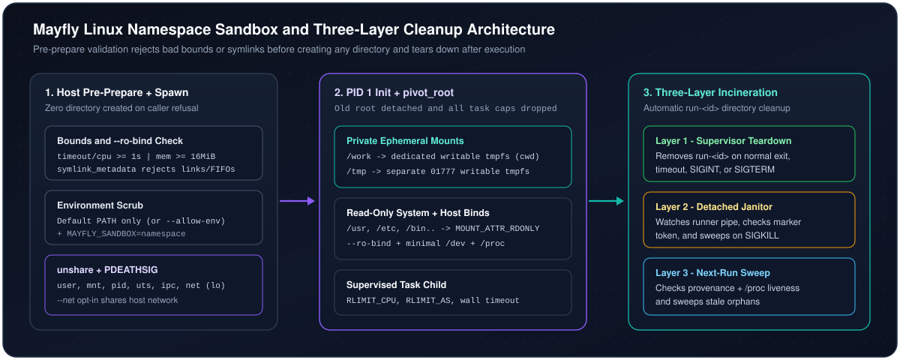

# Mayfly Operator and Sandbox Architecture Guide

Mayfly is a disposable Linux namespace sandbox harness for autonomous agent tasks. Given a managed root directory and a command, Mayfly prepares a fresh sandbox directory, enters isolated Linux namespaces, pivots onto a read-only system view paired with dedicated private writable `/work` and `/tmp` `tmpfs` mounts, supervises the task under PID 1 init, prints one structured JSON `RunReport`, and incinerates the sandbox directory on exit.



## 1. Isolation architecture and filesystem layout

On Linux (`x86_64` and `aarch64`), `NamespaceBackend` spawns each run inside fresh user, mount, PID, UTS (`hostname` set to `mayfly`), IPC, and (unless `--net` is passed, which shares the host network namespace) loopback-only network namespaces with an empty capability set. Inside the sandbox before `pivot_root`, the init assembles a deterministic layout.

| Sandbox path | Mount mode and lifecycle |
| --- | --- |
| `/work` | Dedicated private writable `tmpfs` serving as the task's initial working directory, never backed by host disk and destroyed on exit |
| `/tmp` | Separate private writable `tmpfs` (`01777`), isolated from both host `/tmp` and `/work` and destroyed on exit |
| `/usr`, `/etc` | Host system trees bound recursively and locked read-only across submounts (`mount_setattr` `MOUNT_ATTR_RDONLY` with `MS_RDONLY` fallback) |
| `/bin`, `/sbin`, `/lib`, `/lib64` | Mirrored as symlinks on merged-`/usr` hosts or bound recursively and locked read-only when standalone directories |
| `/dev` | Minimal device nodes (`null`, `zero`, `full`, `random`, `urandom`) |
| `/proc` | Fresh `proc` mount when permitted by the kernel (`proc_mounted` reports `true` or `false` honestly) |
| `--ro-bind HOST:SANDBOX` | Optional caller-granted regular files or directories verified with `symlink_metadata` and locked read-only |

## 2. Granting read-only host inputs (`--ro-bind`)

Tasks start with zero access to host home directories or project trees outside the system binaries. Grant explicit read-only inputs with repeatable `--ro-bind` flags pairing a host source path and an absolute sandbox destination path separated by a colon.

- **Host source checks** run before any sandbox directory is prepared or any orphan sweep runs. Mayfly inspects every source with `symlink_metadata` and refuses missing paths, symbolic links, FIFOs, sockets, and device nodes at `harness_error` (`exit 125`) with zero directory created.
- **Sandbox destination checks** require an absolute path without `.` or `..` segments, forbid reserved trees (`/`, `/.oldroot`, `/proc`, `/dev`, `/sys`, `/usr`, `/etc`, `/bin`, `/sbin`, `/lib`, `/lib64`, `/tmp`, and `/work` itself) while allowing subpaths beneath `/work` (such as `/work/inputs`) or fresh top-level paths (such as `/inputs`), and forbid duplicate or overlapping destinations.

```sh
mayfly run \
  --root /tmp/mayfly-runs \
  --ro-bind ./dataset:/inputs \
  --ro-bind ./config.json:/work/ro/config.json \
  -- /bin/ls -la /inputs /work/ro
```

## 3. Environment scrubbing and `--allow-env`

Mayfly scrubs the caller's environment before starting the task so ambient host credentials never leak into the sandbox.

- **Default allowlist** passes only `PATH` from the caller environment (plus `MAYFLY_SANDBOX=namespace` and `PYTHONCOERCECLOCALE=0`).
- **Explicit `--allow-env KEY` replacement rule** replaces the default `PATH`-only list whenever one or more `--allow-env` flags are supplied. When your task needs both a custom variable and `PATH`, pass `--allow-env MY_VAR --allow-env PATH`. Any NUL byte in an allowlisted key or value is refused before spawn as a harness error.

```sh
API_TOKEN='SYNTHETIC-TEST-VALUE-token' \
  mayfly run \
  --root /tmp/mayfly-runs \
  --allow-env API_TOKEN \
  --allow-env PATH \
  -- /bin/sh -c 'test -n "$API_TOKEN"'
```

## 4. Resource bounds and exit codes

All three resource bounds are opt-in and validated before any directory is prepared (`--timeout` and `--max-cpu` have a `1` second floor, `--max-cpu` has a `18446744073709551614` second ceiling so its `soft + 1` hard limit never overflows `u64`, and `--max-memory` has a `16777216` byte `16 MiB` floor).

| Outcome | CLI exit code | `RunReport` fields |
| --- | --- | --- |
| Task exited normally | Exact task exit code (`0..255`) | `"outcome": "task"`, `"task_exit_code": N`, `"task_signal": null` |
| Task killed by signal (such as `--max-cpu` `SIGXCPU` `24`) | `128 + signal` (such as `152`) | `"outcome": "task"`, `"task_exit_code": null`, `"task_signal": S` |
| Harness error (such as `--timeout`, bad `--ro-bind` source, missing command binary) | `125` | `"outcome": "harness_error"`, `"error": "..."` |
| Malformed CLI arguments (such as missing `--root` or bound below floor) | `2` | Usage or refusal printed on `stderr`, no JSON report printed |

Because a task can itself exit with code `125` or `128 + S`, programmatic supervisors should always inspect `"outcome"`, `"task_exit_code"`, and `"task_signal"` in the JSON `RunReport` rather than relying on the process exit code alone.

## 5. Layered cleanup guarantees

Mayfly uses three independent layers so disposable sandboxes do not accumulate under `--root`.

1. **Supervisor teardown** removes `run-<id>` immediately after the child mount namespace exits (including on `SIGINT` or `SIGTERM` to the supervisor), recording `timings_ms.teardown` and `sandbox_removed`.
2. **Detached janitor** watches a status pipe for unexpected supervisor death (such as `SIGKILL`) and removes the sandbox directory when no verified clean marker token stands.
3. **Next-run orphan sweep** scans `--root` before preparing a new run, checks provenance files and `/proc` liveness after the grace window, and collects identifiable orphaned `run-<id>` directories left behind if both supervisor and janitor were killed (noting `MF-12`'s limit that a double death before born provenance is written can leave an empty `run-<id>` directory requiring manual removal).

## 6. Running the bundled quickstarters

Build the `mayfly` binary first so the helper executable is available, then run both quickstarters (`examples/quickstart.rs` and `examples/sandbox_walkthrough.py`) from a local checkout. On Linux hosts with unprivileged user namespaces enabled they run a full isolated sandbox task, and on macOS or hosts restricting unprivileged user namespaces they verify `RunSpec` construction and pre-prepare bound and bind validation cleanly.

```sh
cargo build --bin mayfly
cargo run --example quickstart
python3 examples/sandbox_walkthrough.py
```

## 7. Optional composition with sibling tools

Mayfly depends on zero sibling crates. In a composed host harness, `portcullis` evaluates proposed commands before execution, `deadbolt`'s `examples/redeem_wrapper.py` injects short-lived scoped tokens into `mayfly run --allow-env`, and `arvin` tracks progress proofs and spend ceilings across runs.
